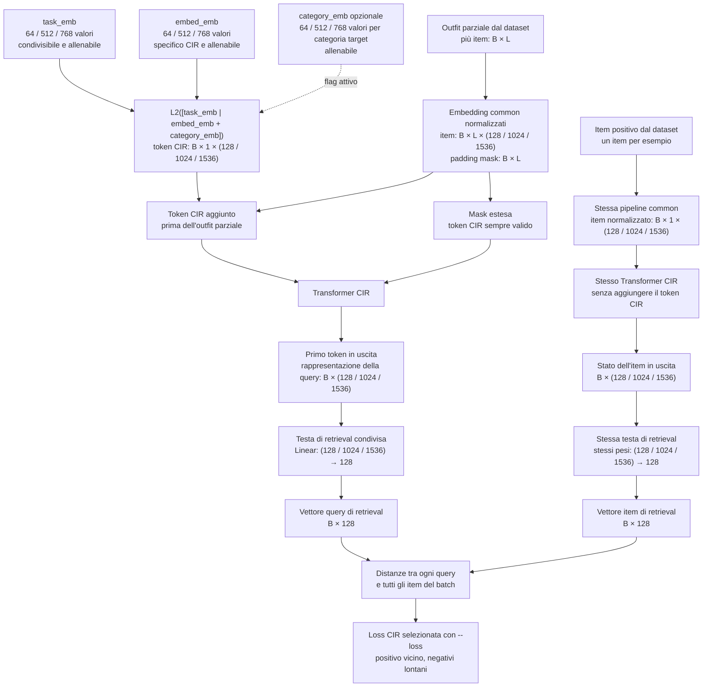
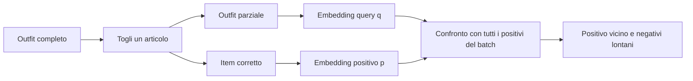

# Complementary Item Retrieval (CIR)

## Indice

- [File](#file)
- [Scopo](#scopo)
- [Architettura](#architettura)
- [Input e output](#input-e-output)
- [Token CIR](#token-cir)
- [Transformer CIR](#transformer-cir)
- [Testa di retrieval](#testa-di-retrieval)
- [Calcolo della loss](#calcolo-della-loss)
  - [Triplet classica](#triplet-classica)
  - [Triplet progressiva](#triplet-progressiva)
  - [InfoNCE pura](#infonce-pura)
  - [Joint InfoNCE e Triplet progressiva](#joint-infonce-e-triplet-progressiva)
- [Condivisione con CP](#condivisione-con-cp)

## File

| File | Cosa fa |
|---|---|
| `category_embedding.py` | Definisce le categorie Polyvore e i relativi vettori allenabili opzionali. |
| `transformer.py` | Costruisce il token CIR e produce gli embedding degli outfit parziali e dei singoli item. |
| `head.py` | Proietta query e item nello stesso spazio vettoriale. |
| `in_batch_triplet_margin_loss.py` | Calcola la triplet margin loss usando i negativi presenti nel batch. |
| `progressive_in_batch_triplet_margin_loss.py` | Media della stessa penalità Triplet su più contesti per outfit, con un unico positivo condiviso. |
| `in_batch_info_nce_loss.py` | Implementa InfoNCE pura e la combinazione con la Triplet progressiva. |
| `__init__.py` | Espone l'API pubblica del package CIR. |

## Scopo

Il modulo CIR impara a descrivere, con un vettore, il capo che dovrebbe
completare un outfit parziale. Non restituisce direttamente un `item_id` e non
interroga un catalogo: produce gli embedding necessari per allenare il modello.

Query e item positivi sono proiettati nello stesso spazio, di default a 128
dimensioni. L'allenamento avvicina l'outfit parziale al suo completamento
corretto e lo allontana dai completamenti sbagliati.

## Architettura

I diagrammi mostrano `64 / 512 / 768` feature per modalità, parte del token
e category embedding: rispettivamente `classic`, `new_classic` o FashionCLIP,
e Marqo FashionSigLIP. Item, token e Transformer hanno larghezza
`128 / 1024 / 1536`; la testa condivisa proietta ciascuna di queste dimensioni
a `128` per default. Gli esempi numerici nel testo usano il default `512`/`1024`.
Il training ricava
la dimensione dal `manifest.json` dei precomputed; evaluation la legge dal
checkpoint. Il manifest è il file descrittivo salvato insieme agli embedding
precomputati (la cache degli embedding).

Il flusso CIR è composto da questi passaggi:

1. il modello common produce gli embedding normalizzati dell'outfit parziale;
2. CIR aggiunge all'inizio il token che rappresenta l'item mancante;
3. il Transformer CIR aggiorna quel token usando gli item presenti nell'outfit;
4. la testa di retrieval trasforma lo stato del token nell'embedding della query;
5. lo stesso Transformer e la stessa testa producono l'embedding dell'item corretto;
6. la loss confronta ogni query con tutti gli item corretti presenti nel batch.



## Input e output

Il modulo riceve gli embedding prodotti dalla parte common del modello.

Per una query CIR:

- gli embedding normalizzati descrivono gli item dell'outfit parziale;
- la maschera distingue gli item reali dal padding;
- il risultato è un vettore per ogni outfit.

Per gli item positivi:

- ogni elemento del batch deve contenere esattamente un item reale;
- il risultato è un vettore per ogni item, nello stesso spazio della query.

La dimensione predefinita dell'output è 128, ma può essere modificata nella
configurazione del modello.

## Token CIR

Senza condizionamento per categoria, il token dell'item mancante nasce
concatenando `task_emb` ed `embed_emb`.

- `task_emb` contiene conoscenza generale sulla compatibilità e può essere
  condiviso con CP;
- `embed_emb` contiene informazione specifica del retrieval CIR.

Con la configurazione predefinita, entrambe le parti hanno 512 valori e il token
completo ne ha 1024. I parametri sono inizializzati con una distribuzione normale
avente deviazione standard 0,02.

Con flag disattivato, il token non contiene immagine, descrizione o categoria
dell'item da trovare. Il modello deve quindi dedurre il completamento soltanto
dall'outfit parziale.

Il condizionamento per categoria è controllato da un flag, disattivato per
impostazione predefinita.

`category_emb` può essere immaginato come un vettore con 11 posizioni, una per
ogni categoria Polyvore. In ogni posizione non si trova un singolo numero, ma un
intero embedding allenabile di 512 valori. Matematicamente la sua struttura è
quindi una matrice `11 × 512`:

- le 11 righe rappresentano le categorie;
- ogni riga contiene il vettore di 512 valori della relativa categoria;
- i valori partono da piccoli numeri casuali e vengono appresi durante il
  training.

Per esempio, quando la categoria target è `shoes`, viene selezionata la riga
associata alle scarpe. Quel vettore viene sommato a `embed_emb`, mentre
`task_emb` resta la prima metà del token. Il token completo diventa:

```text
L2([task_emb | embed_emb + category_emb])
```

Il token completo viene normalizzato L2 a norma 1 dopo la concatenazione e
l'eventuale somma della categoria. Senza categoria si usa
`L2([task_emb | embed_emb])`. L2 agisce sull'intero token, resta differenziabile
e non sovrascrive i parametri allenabili.

Con il flag attivo, ogni outfit del batch deve avere una categoria target. Nel
training questa categoria deriva dal capo corretto rimosso dall'outfit; durante
la ricerca indica invece il tipo di capo desiderato. La loss aggiorna anche il
vettore della categoria selezionata.

Con il flag disattivato, la struttura degli embedding di categoria non viene
creata e il modello deduce il tipo di capo soltanto dall'outfit parziale. Le
categorie ammesse sono
`accessories`, `all-body`, `bags`, `bottoms`, `hats`, `jewellery`, `outerwear`,
`scarves`, `shoes`, `sunglasses` e `tops`.

## Transformer CIR

Il Transformer CIR usa la stessa configurazione architetturale del Transformer CP:

| Parametro | Valore predefinito |
|---|---:|
| Dimensione input/output | 1024 |
| Layer | 6 |
| Teste di attenzione | 16 |
| Dimensione feed-forward | 2024; 512 in `classic`, 3072 con Marqo FashionSigLIP precomputed |
| Attivazione | Mish |
| Normalizzazione | Pre-norm nei layer; nessuna LayerNorm finale aggiuntiva |
| Dropout | 0,3 |
| Positional embedding | Assente |

Per la query, il token CIR viene aggiunto prima degli item normalizzati. La
mask riceve una nuova posizione sempre valida. Lo stato finale del primo token
riassume l'outfit parziale e la richiesta di trovare il capo mancante.

## Testa di retrieval

La testa di retrieval è l'ultimo passaggio sia del ramo query sia del ramo item.
Riceve un vettore da 1024 valori e lo trasforma in un vettore da 128. La stessa
testa, quindi gli stessi pesi appresi, viene usata in entrambi i rami.

È utile distinguere i nomi:

| Nome | Da dove deriva | Cosa rappresenta |
|---|---|---|
| Token CIR iniziale | `[task_emb \| embed_emb]`, oppure `[task_emb \| embed_emb + category_emb]` con flag attivo | Un segnaposto allenabile che chiede «quale item manca?» e può indicarne la categoria target. |
| Rappresentazione della query | Stato finale del token CIR dopo che ha osservato l'outfit parziale nel Transformer CIR | Il riassunto interno della ricerca, con 1024 valori. |
| Vettore query di retrieval | Rappresentazione della query passata alla testa | Il vettore finale da 128 usato per cercare il completamento. |
| Vettore item di retrieval | Rappresentazione di un singolo item passata alla stessa testa | Il vettore finale da 128 che descrive un possibile completamento. |

Non esiste quindi un secondo «token di retrieval». Esiste un solo token CIR,
usato esclusivamente per costruire la query; alla fine vengono prodotti due tipi
di **vettori di retrieval**, uno per la query e uno per gli item.

### Da dove deriva il vettore query

Il dataset fornisce un outfit parziale, per esempio «maglia + scarpe». Il
La pipeline common produce un embedding separato da 1024 valori per ciascun
capo. CIR non concatena questi capi in un unico vettore: aggiunge davanti a essi
il token CIR e passa l'intera sequenza al Transformer CIR.

Grazie all'attenzione, il token CIR raccoglie informazione da tutti i capi
presenti. Il suo stato finale da 1024 valori è la rappresentazione interna della
query. Solo a questo punto la testa esegue la proiezione `1024 → 128` e produce
il vettore query di retrieval.

```text
outfit parziale → common → token CIR + embedding dei capi
                              ↓ Transformer CIR
                     stato finale del token CIR (128 / 1024 / 1536)
                              ↓ stessa testa
                     vettore query di retrieval (128)
```

### Da dove deriva il vettore item

Il dataset fornisce anche l'item positivo, cioè il capo che era stato rimosso
dall'outfit. Immagine e descrizione dell'item vengono elaborate dalla pipeline
common come un outfit formato da un solo capo. La rappresentazione ottenuta
passa poi nello stesso Transformer CIR, questa volta **senza aggiungere il token
CIR**, e infine nella stessa testa `1024 → 128`.

```text
item positivo → common → rappresentazione del singolo item
                              ↓ stesso Transformer CIR, senza token CIR
                     stato finale dell'item (128 / 1024 / 1536)
                              ↓ stessa testa
                     vettore item di retrieval (128)
```

Durante il training l'item deriva da `positive_item`. Durante una futura ricerca
reale, lo stesso procedimento può essere applicato in anticipo a ogni item del
catalogo, così i suoi vettori da 128 sono pronti per essere confrontati con una
nuova query.

La testa non sceglie il prodotto e non contiene un catalogo. Impara soltanto una
trasformazione che mette query e item nello stesso spazio da 128 dimensioni. La
loss organizza questo spazio facendo avvicinare il vettore query al vettore del
capo corretto e allontanandolo dai vettori considerati sbagliati. Per esempio,
una distanza di 0,4 dal capo corretto indica una corrispondenza migliore di una
distanza di 2,1 da un capo sbagliato.

La normalizzazione degli embedding è disponibile ma disattivata per impostazione
predefinita. Se viene attivata, porta ogni embedding a lunghezza 1: il confronto
dipende così dalla direzione dei vettori e non dalla sola grandezza dei valori.

## Calcolo della loss

### Da dove arrivano query, positivo e negativi

Nel training il dataset legge gli outfit completi di `train.json` e sceglie
casualmente un articolo da togliere a ogni accesso. Restituisce il resto come
`partial_outfit`, il capo estratto come `positive_item` e `negative_items=()`.
La stessa regola vale per immagini raw e feature precomputate.

Per esempio, da «maglia + pantaloni + scarpe» si possono ottenere:

- outfit parziale: «maglia + scarpe»;
- item positivo: «pantaloni»;
- in un accesso successivo può essere estratto un altro capo dello stesso outfit.

La loss usa query e positivo di ogni esempio e ricava i negativi dagli altri
positivi presenti nel microbatch. Non richiede distrattori espliciti nel training.

In validazione il dataset usa invece le domande FITB fisse: `question` contiene
la query, `blank_position` identifica il capo corretto e `answers` contiene
positivo e distrattori ufficiali. Questi candidati servono al ranking e alla
validation loss; le domande non vengono ricampionate tra epoche.



### Triplet classica

La Triplet classica (`--loss triplet`) è la loss predefinita. Per ogni query $q$,
misura quanto è vicino il capo corretto rispetto agli altri candidati.

**Distanza euclidea.** Per confrontare l'embedding della query $q$ con quello
di un capo $c$, si sommano i quadrati delle differenze tra le componenti e si
fa la radice.

$$
d(q,c) = \sqrt{\sum_k (q_k - c_k)^2}
$$

Nell'esempio, la query «giacca + camicia» è `q = (0, 0)` e i jeans sono
`c = (3, 4)`. La loro distanza è $\sqrt{3^2 + 4^2} = 5$.

Ogni riga mostra le distanze da una query ai tre capi del microbatch.
Il **positivo** è il capo corretto per quella query. Il **negativo scelto**
è il capo più vicino tra gli altri due.

| Outfit parziale (query) | Jeans | Décolleté | Sneaker |
|---|---:|---:|---:|
| Giacca + camicia | **5 (positivo)** | 8 | **6 (negativo scelto)** |
| Abito | **5 (negativo scelto)** | **6 (positivo)** | 8 |
| Felpa + pantaloni | **5 (negativo scelto)** | 10 | **0 (positivo)** |

**Penalità:** $d_{\text{pos}}$ è la distanza dalla query al capo corretto.
$d_{\text{neg}}$ è la più piccola distanza dalla query ai capi degli altri
outfit del microbatch. Il margine $m$ vale 2 di default. La loss è zero quando
il negativo è almeno $m$ più lontano del positivo.

$$
\operatorname{Triplet} = \max(0,\; d_{\text{pos}} + m - d_{\text{neg}})
$$

Nella prima riga i jeans distano 5 e le sneaker 6. Per rispettare il margine,
le sneaker dovrebbero distare almeno $5 + 2 = 7$. La penalità è
$\max(0, 5 + 2 - 6) = 1$.
Per default si fa la media delle penalità degli outfit del microbatch.

### Triplet progressiva

Con `--loss progressiva` la prima vista usa tutto il contesto disponibile.
Le successive tolgono un capo alla volta, fino a tre viste in tutto. Ogni
vista cerca lo stesso capo corretto e usa il proprio negativo più vicino.

Si fa prima la media delle $V$ viste di ciascun outfit e poi la media tra
i $B$ outfit del microbatch.

$$
\begin{aligned}
L_{\text{outfit}} &=
\frac{\operatorname{Triplet}(\text{vista 1}) + \cdots + \operatorname{Triplet}(\text{vista } V)}{V} \\
L_{\mathrm{ProgressiveTriplet}} &=
\frac{L_{\text{outfit 1}} + \cdots + L_{\text{outfit } B}}{B}
\end{aligned}
$$

Per esempio, con tre penalità $1, 2, 0$ il primo outfit vale $(1+2+0)/3 = 1$.
Se il secondo ha una sola vista con penalità $3$, la loss è $(1+3)/2=2$.
Ogni outfit pesa allo stesso modo.

Le modalità `progressiva`, `join` e `infonce` costruiscono le viste allo stesso modo.
[Guida al training CIR](../../training/CIR/README.md#loss-metriche-e-best-model).

### InfoNCE pura

`--loss infonce` usa `InBatchInfoNCELoss`. Per ogni vista $q$ calcola la
distanza euclidea da ciascun target $p_j$ del microbatch. I logit sono
$s_j = -\lVert q - p_j \rVert_2 / \tau$, con temperatura $\tau = 1{,}0$ nel
training CIR. L'ordinamento dei logit riproduce quello per distanza crescente
usato nel ranking FITB.

Con $y$ pari all'indice del target corretto, la loss della vista è la
cross-entropy dei logit.

$$
L_{\mathrm{InfoNCE}}(q) = -\log \frac{\exp(s_y)}{\sum_{j=1}^{B} \exp(s_j)}
$$

Tutti i target competono nel denominatore, quindi ciascun negativo
contribuisce alla penalità. L'aggregazione fa la media sulle viste di ogni
outfit e poi applica la riduzione sul batch. La formulazione segue il
[paper originale di InfoNCE](https://arxiv.org/abs/1807.03748).

### Joint InfoNCE e Triplet progressiva

`--loss join` usa `JointInBatchRetrievalLoss`. Le due componenti condividono
viste, target e matrice delle distanze. La Triplet usa la distanza dal
negativo più vicino e InfoNCE usa tutti i candidati del microbatch.

$$
L_{\mathrm{join}} = \alpha L_{\mathrm{InfoNCE}}
  + (1 - \alpha) L_{\mathrm{ProgressiveTriplet}}
$$

Il training CIR usa $\alpha = 0{,}5$. Entrambe le componenti pesano ogni
outfit allo stesso modo, tramite la media delle sue viste, e usano la stessa
riduzione sul batch. Il margine della componente Triplet si imposta con
`--triplet-margin`.

## Condivisione con CP

Per condividere davvero `task_emb`, CP e CIR devono usare lo stesso parametro.
In questo caso entrambi i compiti lo aggiornano durante l'allenamento. Altrimenti
CIR usa un parametro proprio e non condiviso.

Il runner [`training/CIR`](../../training/CIR/README.md) compone common e CIR,
gestisce category flag, loss, metriche FITB, checkpoint e resume dei soli pesi.
Con `--pretrained-cp` copia pipeline common, task embedding e tutti i layer del
Transformer CP nel CIR. È un'inizializzazione dei pesi, non una condivisione
degli oggetti tra due training. Token `embed_emb`, categoria e testa retrieval
nascono nel CIR perché assenti nel modello CP locale.
